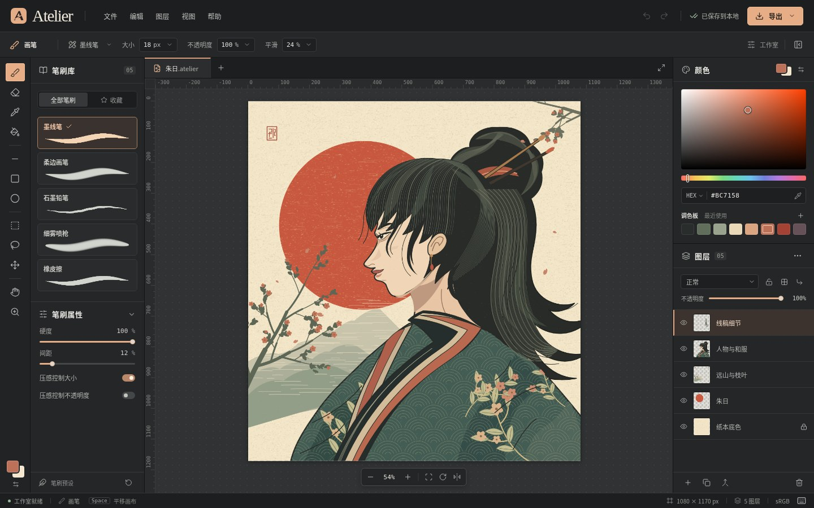

# Atelier

Atelier 是一个中文桌面网页绘画工作室。首次打开时会载入原创分层插画《朱日》。可以直接在作品上试笔，也可以用「文件 → 新建画布」创建透明或白底画布。



## 运行

使用 Node.js 22.12 或更高版本，在项目目录执行以下命令。

```sh
npm ci
npm run dev
```

开发服务默认位于 `http://localhost:5173`。检查类型、构建并预览生产版可执行以下命令。

```sh
npm run typecheck
npm run build
npm run preview
```

生产预览默认位于 `http://localhost:4173`。构建产物在 `dist/`，可部署到静态站点根目录。首次在线访问生产版并完成 Service Worker 缓存后，相同地址可以离线刷新、绘制、保存和导出。Service Worker 需要 HTTPS 或 localhost。

## 绘画与工程

- 使用五种笔刷预设、大小与不透明度压感、平滑和笔尖间距。鼠标输入使用固定压力。
- 支持直线、矩形、椭圆、吸管、矩形与套索选区。移动工具可移动选区内的像素或整个图层。
- 油漆桶支持容差、边缘扩展和所有可见图层取样。关闭边缘扩展可保留严格的匹配边界。
- 可以拖动图层排序、双击名称重命名，设置可见性、不透明度、锁定、Alpha 锁定、剪贴和四种混合模式。图层菜单提供向下合并。
- 调色板支持添加当前前景色，右键移除色样。点击 HEX 可编辑色值，左侧下拉框可切换 RGB 输入。
- 可平移、旋转、水平翻转和缩放视图。底部百分比按钮切到 100%，旁边的适应窗口按钮重新居中。透明区域的显示底色在「视图 → 画布显示」内设置。
- 最近工程自动保存到当前浏览器、当前站点的 IndexedDB。左上文件菜单可下载可迁移的 `.atelier` 文件。它采用版本化 JSON，逐层保存 PNG 像素和图层属性。
- 导出 PNG 可保留透明像素，JPEG 使用白色底。创建或打开工程会替换当前工作区，保留多个作品请分别保存工程文件。

点击画布下方百分比旁的箭头可输入精确缩放比例（5%–3200%）。手动缩放后，切换侧面板会保留视图比例。

「已保存到本地」在浏览器确认 IndexedDB 事务完成后显示。处于「正在保存」时意外终止浏览器或断电，最近的笔迹仍可能丢失。多个标签页发生保存冲突时，可从提示冲突的页面导出工程，保留该页的修改。画作保存在当前浏览器配置中，清除站点数据或结束隐私浏览可能移除画作。重要作品可以通过「文件 → 保存工程」另存独立副本。

## 快捷键

| 操作                       | 快捷键                  |
| -------------------------- | ----------------------- |
| 画笔、橡皮、吸管、填充     | B、E、I、G              |
| 直线、矩形、椭圆           | L、R、O                 |
| 矩形选区、套索、移动       | M、Q、V                 |
| 平移、缩放                 | 空格加拖动、指针下滚轮缩放（5%–3200%）；触屏双指捏合与平移 |
| 撤销、重做                 | Ctrl+Z、Ctrl+Shift+Z    |
| 保存工程、导出             | Ctrl+S、Ctrl+Shift+S    |
| 调整笔刷大小、交换前背景色 | [ 与 ]、X               |
| 取消选区、画布专注模式     | Ctrl+D、Tab             |

## 项目结构

| 位置                  | 内容                                                               |
| --------------------- | ------------------------------------------------------------------ |
| `src/engine/`         | 笔迹采样、脏矩形重绘、填充、选区、图层合成、历史、文件与 IndexedDB |
| `src/state/`          | 工作区状态、笔刷参数、调色板、自动保存调度                         |
| `src/ui/`             | 画布交互、笔刷与颜色面板、图层、菜单、对话框和快捷键               |
| `src/art/`            | 按五个独立像素图层生成的原创示例插画                               |
| `scripts/offline.mjs` | 为本次生产构建生成版本化离线缓存                                   |
| `tests/`              | 针对生产版的 Playwright 浏览器验收测试                             |

活动笔迹在 Pointer Events 中采样和插值，按动画帧合并重绘。一次笔迹对应一个撤销步骤。历史快照复用未修改的像素，保留至多 48 步，并按约 160 MiB 的历史像素预算裁剪。单边画布上限为 4096 px。每个工程最多 64 个图层，同时限制图层总像素数。

## 浏览器测试

```sh
npm test
```

测试会构建生产版、在 4187 端口启动临时服务器并运行 Chromium。云端环境使用系统 Chromium。其他环境可安装 Playwright 浏览器（`npx playwright install chromium`），也可设置 `CHROMIUM_PATH` 指向本机浏览器。测试覆盖像素结果、导出文件实际解码、分层工程往返、压感模拟、自动保存与断网刷新。
